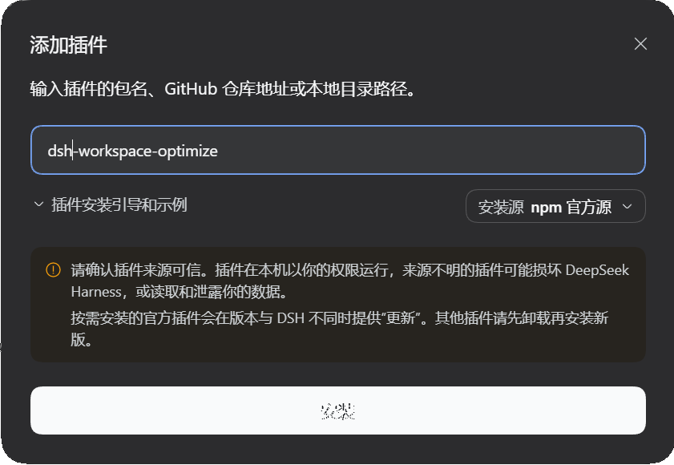

# dsh-workspace-optimize

该插件对 **DeepSeek Harness（DSH）** 的左侧工作区视图进行了增强重绘并添加功能：收藏、颜色标签、工作区自由拖动排序、排序与置顶、会话状态灯与 Windows 通知。

> 支持版本：>= 0.2.0-rc.1

---
## 0.安装
在 DSH Desktop 内安装：在 插件 - 添加插件 对话框内输入该插件包名`dsh-workspace-optimize`即可

通过 npm 安装：
```powershell
npm i dsh-workspace-optimize
```
通过 dsh cli 安装：
```powershell
dsh plugin --profile web add dsh-workspace-optimize
```

---

## 1.特性

### 侧栏

- **增强侧栏切换**：默认开启插件自定义增强侧栏，可切换回原版侧栏
- **收藏、优先级、更改颜色**：同时为工作区文件夹和会话添加收藏、排序优先级和颜色
- **自定义颜色**：预设 9 色之外，可用原生取色器选择任意颜色（`#rrggbb`）
- **色块高亮**（可选）：开启后工作区标题变为圆角色块（自动黑白字），并用同色竖线标出子项范围
- **工作区自由拖动排序**：拖动工作区标题行即可调整顺序，持久化到宿主，重启后保持
- 增强侧栏已基本完全还原原版侧栏功能，保证操作习惯平滑过渡

### 会话状态

- **状态指示灯**：

  | 灯 | 状态 | 预览 |
  | --- | --- | --- |
  | 🔵 蓝色呼吸 | 会话运行中 |  | 
  | 🟡 黄色呼吸 | 等待审批 / 等待回答 / 计划待审 |  |
  | 🟢 绿色常亮 | 已完成 |  |

- 时间位置同步显示「等待审批 / 等待回答 / 计划待审 / 已完成」文字
- **桌面提醒**：等待审批、等待回答、计划待审、完成、出错时发送系统通知（可配置通知类型、免打扰、窗口可见时是否提醒）

### 会话操作（悬停与右键）

- 会话悬停：收藏、归档/恢复、更多菜单；工作区悬停：收藏、新建对话、更多菜单
- 会话与工作区都支持右键打开菜单；鼠标悬停可查看会话信息
- 侧栏头部 ★ 打开收藏面板（收藏的会话与工作区）

### 视图选项（侧栏头部 ☰）

- 分组方式：平铺分组 / 工作区树
- 排序：最近更新 / 手动
- 归档过滤：隐藏已归档 / 全部会话 / 仅已归档
- **色块高亮**（设置项）：工作区颜色以圆角色块呈现，并带子项同色竖线


------

## 使用

### 切换侧栏样式

「设置 → 工作区增强 → 侧栏样式」：

- **增强侧栏**：替换 `sidebar.workspaces` 的渲染
- **官方侧栏**：释放占用，官方侧栏原地位恢复（无需重载）

### 维护区块

桌面端窗口没有浏览器刷新入口，因此设置页提供：

| 控件 | 用途 |
| --- | --- |
| 刷新侧栏数据 | 只重新拉取侧栏数据，不重载页面 |
| 重新加载界面 | 重载页面以加载更新后的 `client.js`（会丢失未发送的输入） |
| 界面版本 | 对比页面与 Host 的界面修订号，不一致时按钮高亮提示重载 |

> Host 半（`index.js`、`lib/`）的更新仍然需要重启应用，页面重载无法加载。

### 空会话与僵尸会话

- 没有任何消息的空白草稿默认隐藏（与官方一致）
- 打开「显示空白会话」后，它们的标题显示为「新建会话」，便于识别
- 官方不支持删除会话，只能归档；本插件不提供删除

---

## 设置项

设置页与 `/state` 中的 `settings` 字段一一对应：

| 字段 | 默认 | 说明 |
| --- | --- | --- |
| `enabled` | `true` | 插件总开关（通知与状态广播仍会工作，仅关闭通知） |
| `sidebarMode` | `optimized` | `optimized` 增强侧栏 / `native` 官方侧栏 |
| `showBlankSessions` | `false` | 是否显示空白会话草稿 |
| `workspaceHighlight` | `false` | 工作区色块高亮（圆角色块 + 子项竖线） |
| `notify.complete` | `true` | 会话完成时通知 |
| `notify.waiting` | `true` | 等待你确认时通知 |
| `notify.error` | `true` | 会话出错时通知 |
| `notify.started` | `false` | 会话开始运行时通知 |
| `notifyWhenVisible` | `false` | 窗口可见时也通知 |
| `dnd.enabled` | `false` | 免打扰时段开关 |
| `dnd.start` / `dnd.end` | `23:00` / `08:00` | 免打扰时段（本地时间） |

---

## 通知

- 来源：Host 监听宿主会话事件（`api-session/status`、`api-session/activity`、`api-session/error`、`session/event`、`approval/request`、`user-questions/request`），把事实推给浏览器半
- 通道：SSE（`EventSource`）为主，失败时回退为轮询
- 展示：`Notification` API → Windows 通知中心；点击跳转到对应会话
- 正文格式：
  - 完成：标题「会话已完成」，正文「会话标题 + 回答摘要（约 60 字）」
  - 等待交互：标题「等待你的确认」，正文「会话标题 + 所需权限 / 问题标题」
  - 计划待审：标题「计划待审」，正文「会话标题 + 计划摘要」
- 权限被拒时降级为页面内提示；桌面模式通常已授权
- 页面关闭后不再收到通知（通知依赖页面进程）

---

## 数据与隐私

- 本插件自己的数据是一个 JSON 文件：`%USERPROFILE%\.dsh\workspace-optimize-state.json`
  （Host 进程设置了 `DSH_PROFILE_DIR` 时落在该 profile 目录）
- 内容：颜色、优先级、设置、工作区收藏、自建会话收藏
- 纯本地、无遥测、无外部网络请求；HTTP 接口只监听本机 DSH 的 loopback 端口
- 附件/会话日志始终由 DSH 自己管理，本插件不复制、不上传

---

## 兼容性

| 依赖 | 必需性 | 影响 |
| --- | --- | --- |
| DSH `0.2.x` | 必需 | 宿主版本 |
| `@michengai/dsh-archive-manager` | 可选 | 提供收藏共享（两处星标一致）与跨工作区移动；缺失时收藏由本插件保存、移动入口隐藏 |
| 官方 `Schedule` | 内置 | 有活跃定时任务时在会话行显示时钟标记 |
| 通知权限 | 可选 | 被拒时降级为页面内提示 |

说明：本插件不声明 `sidebar.workspaces` 的子插槽（`sidebar.workspaces.session.*`），因此 Archive Manager 等第三方插件的**行级菜单**不会出现在增强侧栏中；它们的设置页入口不受影响。

---

## 已知限制

1. **不支持删除会话**：官方没有删除 API（只能归档），本插件同步该语义
2. **行级子插槽不声明**：Archive Manager / Schedule 的会话行菜单在增强侧栏中不显示（Schedule 的时钟标记由本插件用官方数据自绘代替）
3. **排序模式**：「手动」写入宿主会话顺序；「最近更新」严格按最近用户消息时间排，手动排序在该模式下不可见
4. **状态灯是内存态**：完成绿灯在重载页面后清空；「最近修改时间」优先使用日志文件 mtime，重启后可能短暂回退到创建时间
5. **正文搜索**最多展示 30 条结果，不做全文分页
6. **跨工作区移动**会搬迁会话日志并改写工作目录；运行中的会话、子代理会话、目标已存在同名日志会被拒绝
7. **页面关闭后无通知**
8. 侧栏替换属于 `shadows-shipped-ui` 类型的扩展，DSH 大版本升级后可能需要适配

---

## 常见问题

**切回官方侧栏后侧栏空白？**
本插件注册时不声明子插槽，正常情况下撤销注册即可原地恢复官方侧栏。若遇到空白，用「设置 → 工作区增强 → 维护 → 重新加载界面」重载一次。

**增强侧栏不显示？**
检查设置里「侧栏样式」是否为「增强侧栏」；修改后如未生效，重载界面（或重启应用）。

**归档后会话行没有立即消失？**
归档采用乐观更新，行会立即按当前过滤隐藏/出现，随后后台静默校正。

**状态灯或侧栏刷新慢？**
侧栏数据有服务端缓存：日常状态更新是毫秒级。只有三种情况会重建一次（约 1～4 秒）：首次启动、标题投影缓存过期（5 分钟）、新会话出现。属一次性成本。

**通知没有弹出？**
依次检查：系统通知权限、设置里的通知类型开关、免打扰时段、`窗口可见时也通知` 是否开启。

**会话显示「新建会话」？**
这是没有任何消息的空白草稿；在设置里关闭「显示空白会话」即可隐藏。

**拖动工作区后顺序又回去了？**
拖动会先本地排序、再写入宿主的 `workspaceRegistry` 顺序。若刷新后回退，通常是宿主拒绝了该位置（例如跨层级拖动的锚点无效），重试一次或把目标放在同级兄弟之间即可。

**颜色面板拖动时关闭了？**
已修复：颜色面板里的优先级滑块不再在拖动时关闭窗口，改为节流保存。

---

## 开发

- 纯 ESM，无构建步骤：`index.js`（Host）与 `client.js`（浏览器，Module Loader 格式）
- 语法检查：

```powershell
node --check index.js
node --check client.js
node --check lib/api.js
node --check lib/sidebar.js
node --check lib/state.js
node --check lib/adapters.js
node --check lib/events.js
```

- 分支：`main` 为稳定版；`dev` 为开发分支（新功能先在 dev 验证）
- 说明文档：[docs/SIDEBAR-REWRITE.md](docs/SIDEBAR-REWRITE.md)（侧栏替换的设计与实现）、[docs/RESEARCH.md](docs/RESEARCH.md)（宿主扩展点调研）

### 目录

```
index.js          Host 半入口（apply / inject）
client.js         浏览器半（插槽、侧栏、弹层、通知、搜索）
lib/state.js      插件自有状态读写与校验
lib/adapters.js   收藏 / 移动 / 置顶 / 排序目标适配
lib/events.js     宿主会话事件采集（状态、活动、错误）
lib/sidebar.js    自绘侧栏数据源（工作区、会话、归档/置顶、定时任务）
lib/api.js        /api/workspace-optimize/* 路由与 SSE
locale/           插件显示名与描述
docs/             设计文档
```

---

## License

[MIT](LICENSE)

本插件为社区项目，与 DeepSeek AI 官方无隶属关系。
